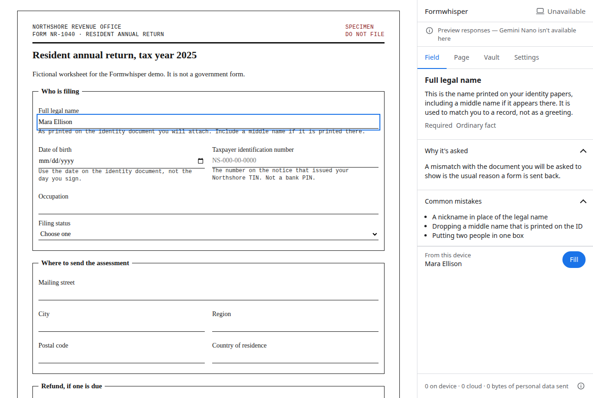
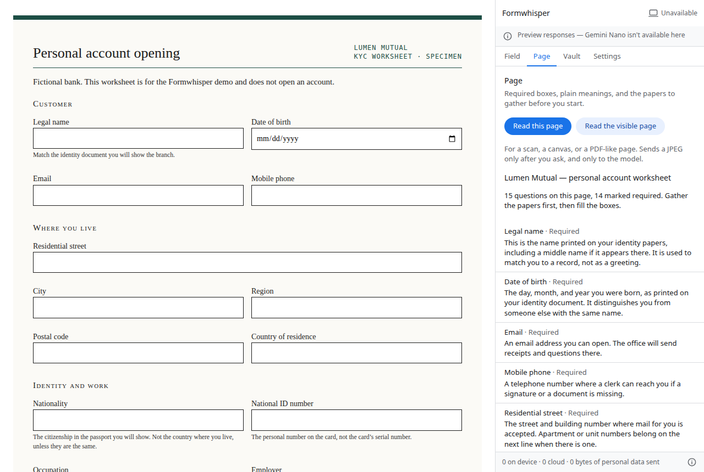
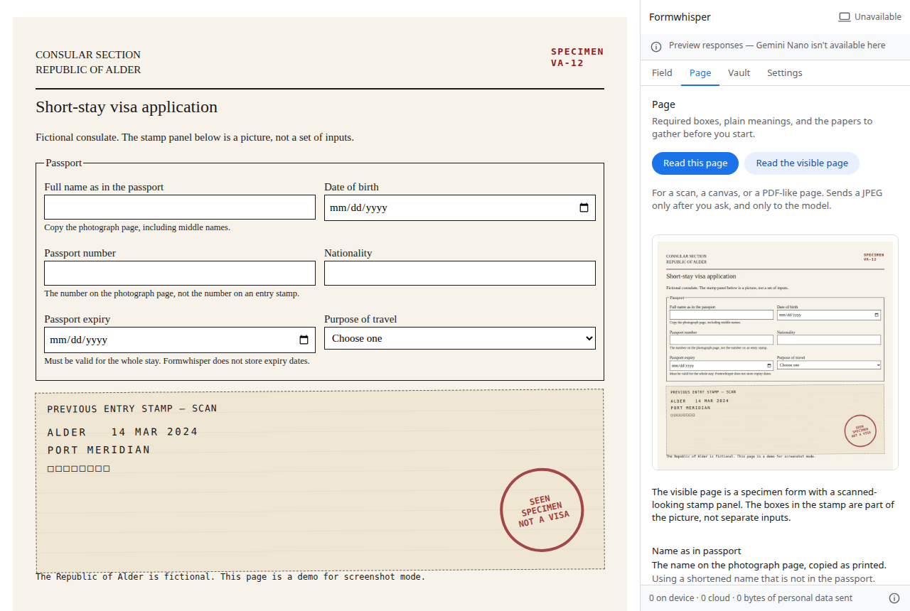
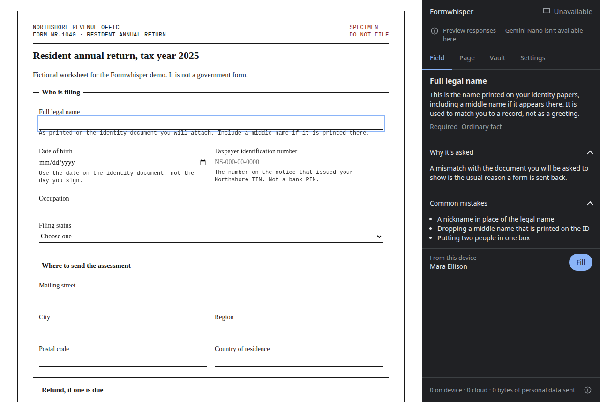

# Formwhisper

Formwhisper is a Chrome side panel for forms that assume you already know the jargon: tax, banking, visas, KYC, benefits, insurance. Focus or hover a field and it explains, in plain language, what the question means, why it is asked, and the mistakes people make. If the question matches a fact in a **local vault**, one button places that fact in the field.

The vault lives in `chrome.storage.local`. It can be sealed with a passphrase (PBKDF2 and AES-GCM). It is never copied into a prompt.

English is the interface language required for the [#BuildHybridAI 2026](https://firebasehybridaihackathon.devpost.com/) demo. Bahasa Indonesia is available in Settings for the chrome of the panel. Prompts stay in English.

## Hybrid inference

Firebase AI Logic hybrid mode is the product, not a fallback pasted on at the end. The calls are in `src/lib/hybrid-firebase.ts`, written to match the [web hybrid guide](https://firebase.google.com/docs/ai-logic/hybrid/web/get-started) and the official `firebase-ai-logic-basics` skill (installed under `.agents/skills` from [Firebase agent skills](https://firebase.google.com/docs/ai-assistance/agent-skills)).

| Request | Mode | Why |
| --- | --- | --- |
| Field explanation | `PREFER_ON_DEVICE` when Gemini Nano is already available, otherwise `ONLY_ON_DEVICE` if cloud is forbidden, otherwise `ONLY_IN_CLOUD` after an explicit consent dialog | Single-turn text plus a JSON schema. Supported on device. |
| Page checklist | Same choice | One structured JSON object for the whole form. Still a single turn. |
| Visible-tab JPEG | Same choice, with image+text inputs | On-device hybrid accepts JPEG and PNG. PDFs are not sent; the panel photographs the visible tab instead. |

Cloud calls use the Gemini Developer API (`GoogleAIBackend`) on the Spark plan. The cloud model is `gemini-4-hydrogen` (featured, billing not required, as of the models page in November 2026), passed in `inCloudParams.model`. The SDK's own hybrid default is `gemini-3.5-flash-lite`; change `cloudModel` in the gitignored config if you want that default instead. Sampling parameters that Gemini 3 and later ignore (`temperature`, `topP`, `topK`) are not set.

`getAI` is created with `useLimitedUseAppCheckTokens: true`. Every answer shows `ON_DEVICE` or `IN_CLOUD`. A ledger counts those two and keeps **personal data sent at 0 bytes**, because vault values are matched in code after the model returns a semantic type. They are not in the prompt.

`PREFER_ON_DEVICE` is used only when `LanguageModel` already reports `available`, so the SDK does not silently fall through to the cloud. If the model is missing, the panel asks before any cloud call. **Never use cloud** switches the mode to `ONLY_ON_DEVICE`.

What does **not** run on device, and so is not used: multi-turn chat, audio, PDF documents, function calling, and grounding.

This machine cannot run Gemini Nano. `src/lib/mock-model.ts` answers the specimen forms so the panel can be screenshotted. The badge on those answers says `PREVIEW`. The Firebase calls are still compiled into the extension and covered by `tests/hybrid-wiring.test.ts`.

## Vault

Facts (name, address, date of birth, id numbers, and so on) stay on the device. The model returns a `semanticType` from a fixed enum. `matchVault` maps that enum onto a vault key. A routing number, a source of funds, or a passport expiry has no vault key, so nothing is filled.

## Screenshots

Taken in the preview studio with the local provider. The `PREVIEW` badge is intentional.









Panel-only shots at 420px: [onboarding, dark](docs/screenshots/field-onboarding-dark.png), [field, dark](docs/screenshots/field-explanation-dark.png), [vault, dark](docs/screenshots/vault-dark.png), [settings, dark](docs/screenshots/settings-dark.png), [field, light](docs/screenshots/field-explanation-light.png).

## Develop

```bash
npm install
npm run check   # lint, typecheck, unit tests, extension build
npm run dev     # specimen desk at http://127.0.0.1:43123
npm run build   # unpacked extension in dist/
```

Load `dist/` from `chrome://extensions` with Developer mode on. The specimen forms are served by `npm run dev`. Opening the side panel injects one self-contained `content.js` into that tab's top frame. Pages with no fields get no listeners. Debug App Check does not load reCAPTCHA.

Firebase project, App Check, and the Chrome flag are in [SETUP.md](SETUP.md). No API key or debug token is committed.

## Layout

- `src/sidepanel` — panel UI
- `src/content` — field detection and fill
- `src/lib/hybrid-firebase.ts` — Firebase AI Logic hybrid and App Check
- `src/lib/mock-model.ts` — preview provider
- `samples/` — three fictional forms
- `.agents/skills` — Firebase agent skills used to implement the Firebase parts

Apache-2.0. See [LICENSE](LICENSE).
